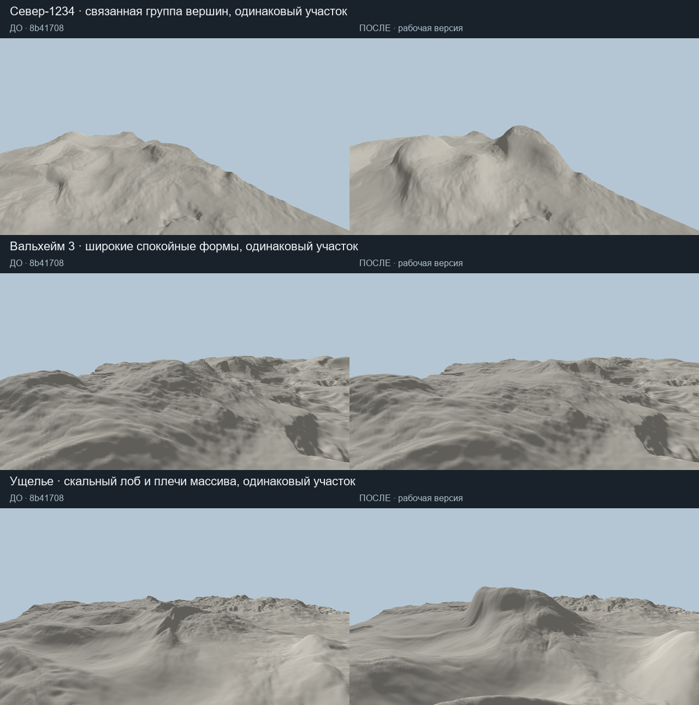
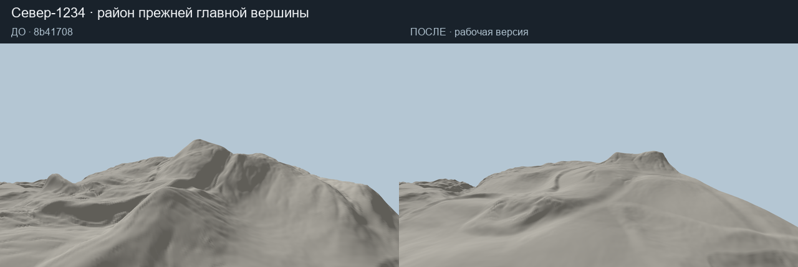
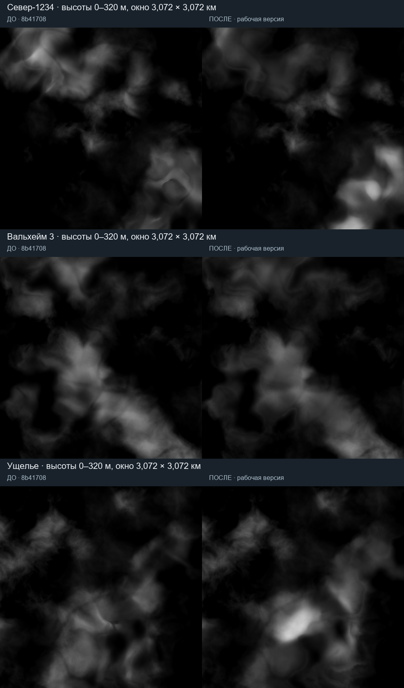
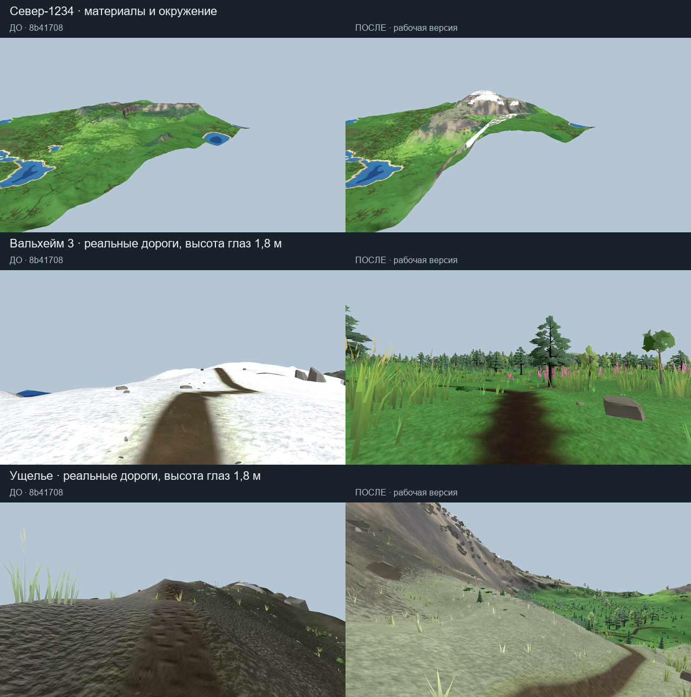
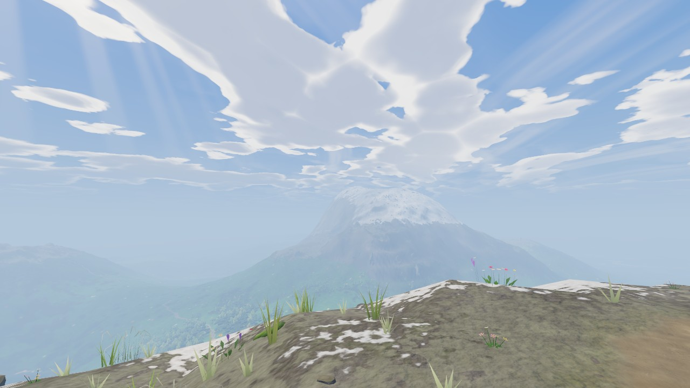
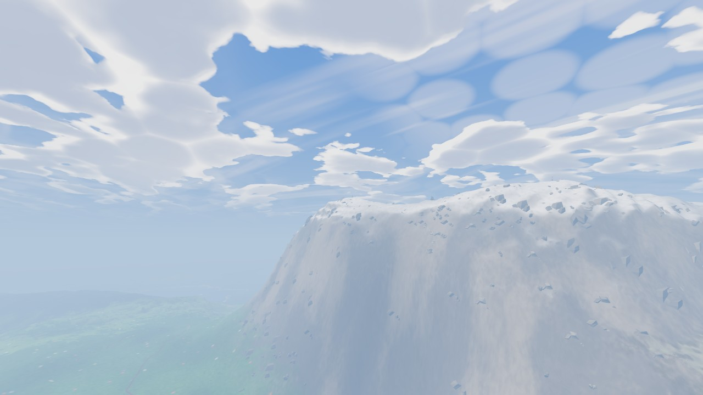

# Связанные горные системы — 10.11.2026

Основа: `New-water-generation`, `8b41708`. Сравнение сделано с этой ревизией,
а не с `064dd48`, использовавшейся в старых горных стендах.

## Что изменилось

Прежняя форма складывалась из направленного ridged-шума, отдельного поля
внутренних долин, боковых ложбин, отрогов и нескольких поправок плеча.
Независимое континентальное основание частично заполняло полученные долины.
Раннее мягкое ограничение высоты уменьшало различия верхних форм.

`StageRelief._crest` теперь вычисляет расстояния до разреженного скелета:
извилистого водораздела и прикреплённых к нему боковых рёбер. Противоположные
борта получают разные места ответвлений, длины, ширины и изгибы. Высота ребра
убывает к его окончанию; промежутки образуют боковые долины. Седловины
определяются изменением высоты связанного водораздела.

Часть рёбер имеет устойчивый скальный лоб и плечо в средней части, с пологим
окончанием ниже. Этот профиль следует координатам ребра и постепенно исчезает
у его корня и конца. Он формируется **до воды, поселений и поиска дорог**.
Спокойные возвышенности сохраняют более широкие, низкие и мягкие формы.

Континентальное основание внутри массива понижается в соответствии с теми же
долинами. Предгорья, маска гор, широкие профили GEO 7, переход к равнине и защита
берега сохранены. Общая повторная коррекция плеча удалена; вершины и мягкий
предел высоты перенастроены под новый профиль.

Скелет адресуется мировыми координатами через существующую перестановку сида.
Он не хранит граф, массив новых полей или результаты симуляции. Размер запроса,
порядок фоновых задач и границы карты не определяют его форму. Численная копия
находится в `FastGrid.Relief.cs`.

## Связанные системы

- `MountainDetail` продолжает уточнять уже сформированные склоны. Его амплитуда
  не увеличивалась; он не отвечает за создание крупных отрогов.
- `RockRelief` остаётся поздним слоем небольших уступов с защитой дорог и воды.
  Значимые скальные лбы теперь присутствуют в исходной географии.
- Крупные формы видны в меше независимо от дальности растительности. Дальность
  всех камней и деревьев не увеличивалась.
- Климат различает влажное пологое высокогорное плечо и открытую стену на той
  же высоте: первое получает тундровое сообщество, вторая — скалу. Существующие
  открытость породы, посадка скальных моделей, осыпи и растительность читают
  полученную геометрию через прежние механизмы.
- Обзор дорог сохраняет шаг 32 м и существующее уточнение формы/уклона через
  16 м в горах. Ширина новых рёбер и долин позволяет видеть их на этом обзоре;
  поиск дорог также проверяет исходную игровую поверхность.
- `OuterLand` использует тот же `raw_rect`; отдельной внешней географии нет.
- `SCHEMA_GEO_VERSION = 16` инвалидирует географию и зависимые слои, включая
  производные поверхности. Формат сохранённых полей не менялся.

## Как воспроизвести сравнение

До изменения генератора:

```text
godot --headless --path . --script res://tools/mountain_relief_test.gd -- --snapshot before
```

После сборки `dotnet build --no-restore`:

```text
godot --headless --path . --script res://tools/mountain_relief_test.gd -- --snapshot after
godot --headless --path . --script res://tools/mountain_relief_test.gd -- --analyze-snapshots
godot --path . --script res://tools/mountain_compare_look.gd -- --snapshots --seed Ущелье
```

Снимки и исходные численные поля: `.godot/mountain_structure`. `--focus after`
выбирает новый главный массив, сохраняя **одинаковый географический ракурс для
обеих версий**. Для Севера сохранены и прежняя, и новая главные вершины.

Нейтральные виды используют однородный материал, одинаковый свет и рельеф без
растительности и скальных моделей. Карты высот имеют общую шкалу 0–320 м.
Камеры панорамы и бокового вида совпадают. Нейтральный вид игрока имеет общие
плановые координаты и высоту 1,8 м над поверхностью каждой версии.

Виды с оформлением используют окончательный `Heightfield`, настоящий материал,
растительность, скалы и дорожное полотно. Камера велосипедиста выбирает реальную
дорогу возле рассматриваемого массива в каждой версии; эти дороги могут
различаться, поэтому это сопоставление географической ситуации, а не пиксельный
тест. Статический стенд не рисует весь набор узлов полной игровой сцены.

## Проверки

- `dotnet build --no-restore`: 0 ошибок и предупреждений.
- `mountain_relief_test --contracts-only`: native/reference, климат, параллельность,
  непрерывность окон скелета — 0 failures.
- `mountain_detail_test` на трёх контрольных сидах: одинаковые float32-результаты
  C#/GDScript, соседние прямоугольники, отрицательные координаты, halo полос и
  независимые параллельные запросы — 0 failures.
- Пять полных географий: конечные высоты, сток рек вниз, сухие дома и связность
  опубликованной сети — без нарушений этих проверок.
- `water_surface_test`, `cache_schema_test`: 0 ошибок.
- Полная игровая сцена: реальная сверка климата и стоимости C#/GDScript прошла.
  Проверка самой велосети и повторного fingerprint приведена ниже.

## Численные результаты

Это диагностика распределения форм и маршрутов, а не оценка художественного
качества. В ячейках таблиц показано «было → стало».

| Сид | Поселения, предложено/опубликовано | Максимум, м | Склоны >100% в горах, % | Native raw_rect, мс |
|---|---:|---:|---:|---:|

| Север-1234 | 11/11 → 11/11 | 222 → 226 | 5.6 → 10.0 | 106 → 294 |
| Вальхейм 3 | 13/13 → 13/13 | 171 → 161 | 3.7 → 1.8 | 97 → 253 |
| Ущелье | 8/7 → 8/7 | 155 → 261 | 4.1 → 7.3 | 99 → 241 |
| Туман-4821 | 12/12 → 12/11 | 186 → 249 | 5.1 → 6.9 | 104 → 289 |
| Каменный берег | 13/12 → 13/13 | 164 → 211 | 5.2 → 7.2 | 98 → 283 |

Склоны измерены центральной разностью на сетке 4 м в клетках выше 52 м.
Native-время — медиана трёх прогонов `raw_rect(768 × 768)` с детализацией,
без выбора старта, нормировки и микрорельефа. География целиком (с водой,
производными и климатом) занимает 2,0–2,9 с в этом прогоне. Планирование
обычных дорог, мест и их поверхности — 16,3–21,2 с; это остаётся существенной
стоимостью генератора. Новый скелет не добавляет постоянных растровых полей.

| Сид | Маршруты выше 52 м, км | Верхняя точка маршрутов, м | Наибольший спуск, м |
|---|---:|---:|---:|
| Север-1234 | 11.1 → 5.6 | 168 → 197 | 125 → 82 |
| Вальхейм 3 | 9.4 → 7.9 | 171 → 161 | 135 → 138 |
| Ущелье | 4.9 → 7.7 | 147 → 168 | 86 → 138 |
| Туман-4821 | 14.4 → 13.1 | 178 → 217 | 118 → 175 |
| Каменный берег | 4.1 → 2.9 | 145 → 136 | 83 → 103 |

Здесь учитываются опубликованные road/trail/mountain, без animal. Это сумма
длин маршрутов, перекрытия общих участков не удалены. Высоты взяты из клеточной
географии, а не из метровых дорожных патчей. Спуск — перепад от вершины до
низшей точки до накопленного обратного подъёма более 2 м. Он не является
сертификацией велосипедной трассы.

В «Ущелье» и «Тумане» выросли доступные перепады и высотный охват. На «Севере»
горных километров стало меньше, хотя дороги достигают более высокой отметки.
Промежуточный вариант давал там лишь 2,7 км выше 52 м: расстояние между
хребтами уменьшено, в принятом варианте — 5,6 км. Прежние 11,1 км не восстановлены.

У «Тумана-4821» остался один отсечённый кандидат поселения: 11 из 12 вместо
12 из 12. В профиле — отказ `bridge_site` и последующие `unreachable` для его
связей. Остальные поселения образуют связную сеть. Это оставшаяся потеря,
а не доказательство отсутствия регрессий. У «Каменного берега», напротив,
опубликованы все 13 кандидатов вместо прежних 12.

## Наблюдаемая форма

На «Севере» появились более мощные скальные лбы и связанная группа вершин;
главный высотный акцент переместился. Район прежней вершины показан отдельно.
«Ущелье» получило более высокий ступенчатый массив с широкими плечами и
выраженной боковой стеной. «Вальхейм 3» стал более спокойным и широким: здесь
уменьшились резкие локальные формы. Изменение не сводится к одинаковому
усложнению всех гор, и визуальный эффект не одинаков на всех сидах.

Слева в каждой паре — `8b41708`, справа — рабочая версия. Нейтральный материал:



Район прежней главной вершины Севера — та же камера в обеих версиях:



Карты высот в едином масштабе, без растяжения сторон:



Материалы, камни, растительность и обычные дороги. Для «Вальхейма 3» и
«Ущелья» показаны реальные маршруты с высоты глаз. Это разные дороги возле
одного рассматриваемого массива, а не одинаковая мировая позиция:



На полном игровом просмотре обнаружено растягивание белых клеток биома по
крутой стене. Снежная маска теперь учитывает геометрический наклон: снег остаётся
на плечах и полках, крутой лоб получает материал породы. В сравнении «до»
используется прежний shader, в нейтральной проверке оформление не участвует.

Численные свидетельства: [results.json](images/mountain_structure_2026_11_10/results.json).
Полные binary-снимки, исходные PNG и координаты камер сохранены локально
в `.godot/mountain_structure`; они не включены в Git.


## Полная игровая сцена и оставшиеся ограничения

`tools/control/check.gd`, «Ущелье», 768 × 768, штатный Forward+, 1280 × 720,
GTX 1650 SUPER / Ryzen 7 2700. Велоплан: `found`, 12 маршрутов, 5 707 м,
без quick-режима. Повторная генерация после поправки снежного материала
совпала по полному fingerprint: `ok: true`, различий нет.

Осмотр: 131 FPS. Пролёт по дороге: 102 FPS, 1% low 76 FPS, p99 13.2 мс. Зафиксированы 2 кадра дольше 33,3 мс, максимум 215 мс. Холодная загрузка — 62.4 с. RSS после прогона — 2438 MiB, пик — 3146 MiB.

Быстрой загрузки всего мира за несколько секунд пока нет: основное время
приходится на дорожное планирование, велоплан и подготовку растительности.
Сопоставимого FPS-прогона исходной ревизии нет, поэтому отсутствие новых
статтеров и регрессии памяти не доказано. Измеренный пролёт не заменяет
длительной поездки с физикой велосипеда. Дальняя дымка в полной сцене
смягчает видимость форм на противоположном склоне.

Стенд завершился с кодом 0, но Godot сообщил о 968 оставшихся ObjectDB instances
и 22 ресурсах при выходе. Происхождение этих сообщений не установлено;
они не включены в утверждение «проверки без ошибок» выше. Счётчик травы также
показал отставание до 63,1 м при указанном запасе 45 м. Эти вопросы остаются.

Полная сцена, камера на реальной горной дороге на высоте 1,8 м:



Крупный вид стены в полной сцене:



Проверены пять сидов и короткий игровой прогон одного из них. Оценка
долговременной игровой производительности и всех возможных сидов остаётся
за пределами этой итерации. Рабочие изменения оставлены в текущей ветке,
коммит не создавался.
