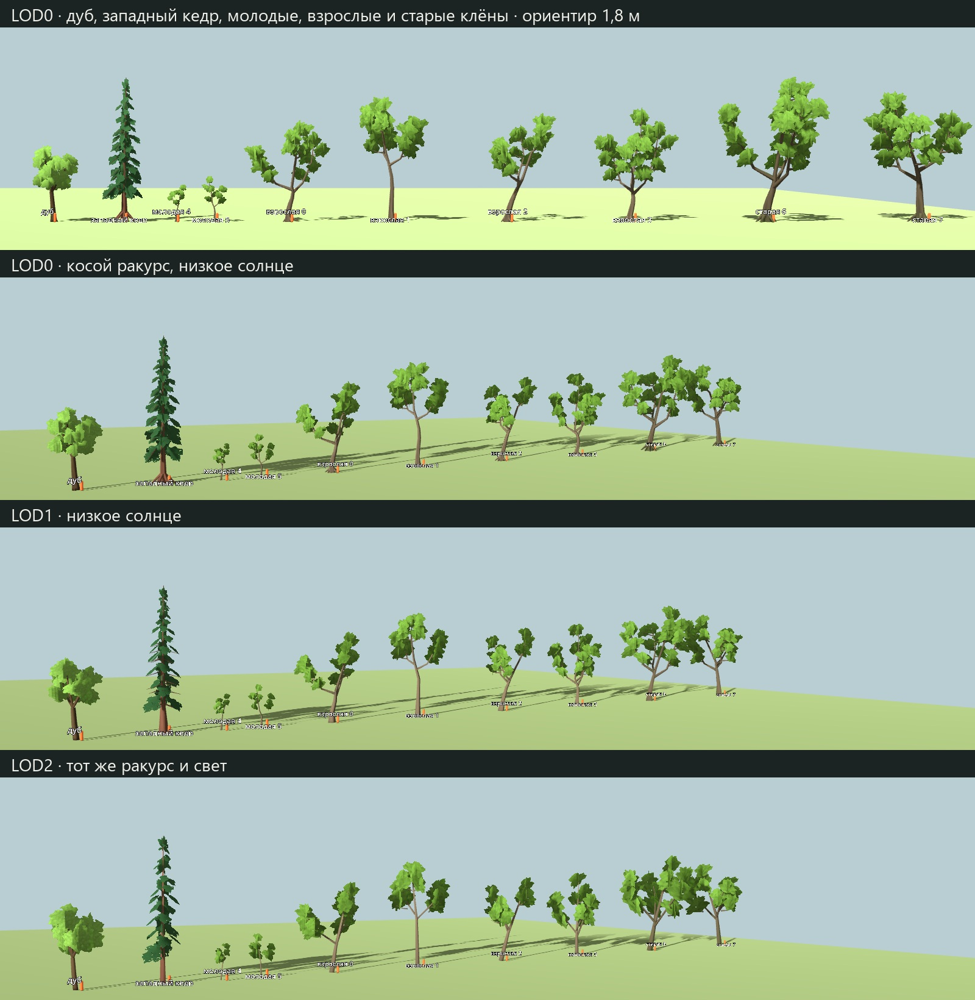
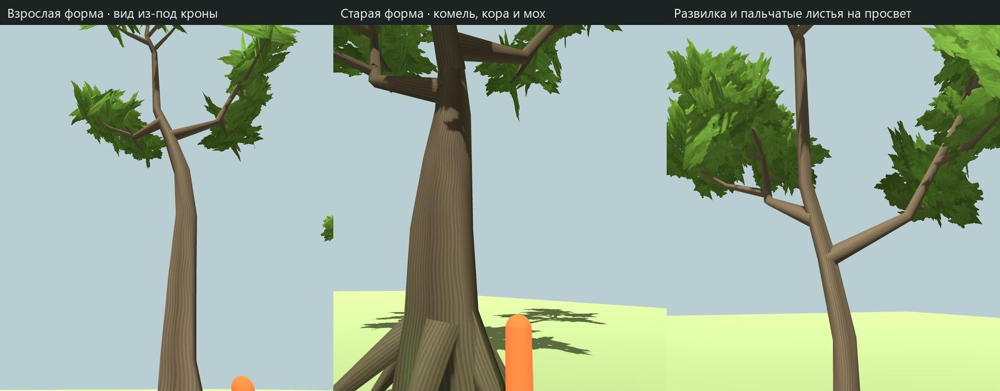
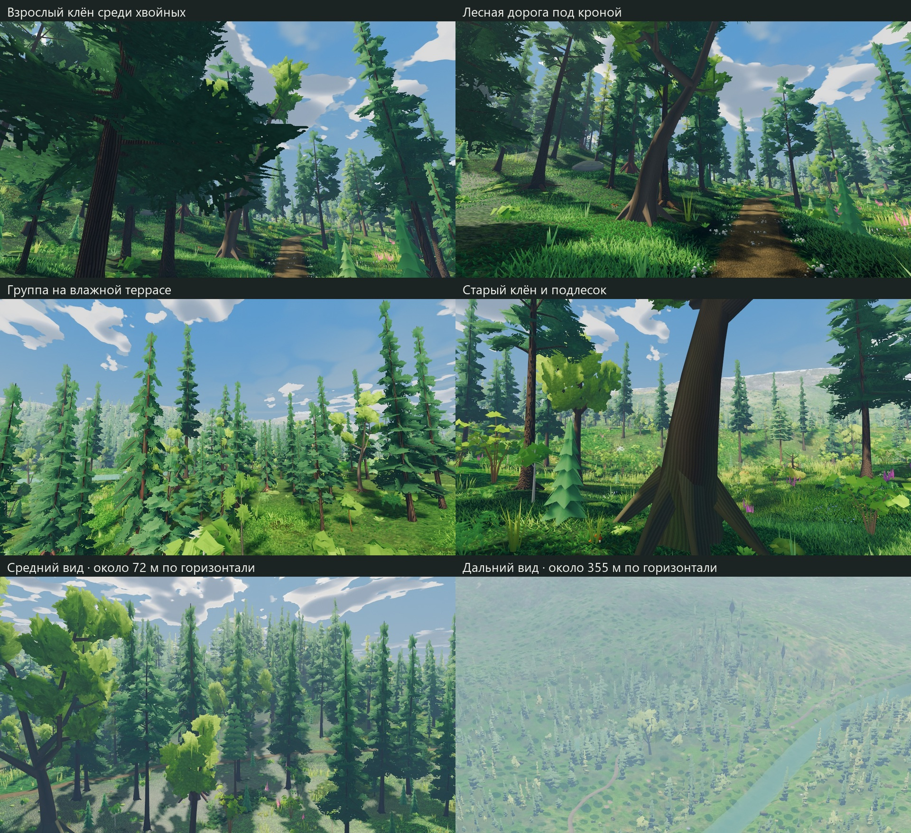

# Фаза 8.1 · Клён крупнолистный

## Модель и размещение

У `Acer macrophyllum` восемь силуэтов в существующих возрастных классах. Два молодых стройных дерева, четыре взрослых с разной высотой развилки, наклоном и шириной кроны, два старых с широким комлем и корневыми лапами. На стенде взрослые формы достигают 20,8–25,5 м, старые — 27,3–29,4 м. Боковые ветви изгибаются наружу и несут группы пятилопастных листьев. Листья используют один атлас с mipmaps. У старых форм мох смешан с корой через цвет вершин на комле, развилках и верхней стороне крупных ветвей.

Клён заменяет часть кандидатов на посадку ели в `FOREST` и `TAIGA` Речной экспедиции. Для выбора используются существующие поля высоты, влажности, освещённости, полога и близости воды. Крутой склон и обнажённая порода снижают вероятность. В зрелых древостоях повышается доля старых форм клёна. Для низкой кроны молодняка увеличен отступ от дороги. Расстояния между соседями, коллизии стволов и учёт лиственной подстилки проходят через общие системы. Обновлён ключ производных слоёв кэша экспедиции.

## Стенд моделей

## Кадры River Expedition

Сид «Север-1234», короткий план `256 × 768`, штатное освещение `GameWorld` в 10:30. На плане 106 клёнов, около 0,33% всех деревьев. Среди них 56 молодых, 47 взрослых и три старых. Три взрослых или старых дерева находятся в пределах 12 м от оси дороги. Ствол в дорожном кадре отстоит от оси на 5,26 м. Ближайший к воде клён на проверенном плане стоит в трёх клетках от неё. Общее число объектов раскладки изменилось с 40 995 до 40 960.

С седла лучше всего видна мощная развилка, а крона частично выходит за верхнюю границу кадра. На среднем плане клён читается по ширине групп листвы и горизонтальным ветвям. На дальнем плане видимость отдельных крон зависит от дымки и перекрытия хвойными. Мох на старом стволе даёт приглушённый зеленоватый тон, особенно у основания. В игровом кадре папоротники остаются второстепенной частью подлеска.

## LOD и стоимость

Ближний лес использует штатные три меша LOD, материалы с alpha cutout, ветер, тени и MultiMesh. В LOD2 у клёна сохраняются ствол и основные развилки. Дальнее представление использует карточки широкой кроны в древесном классе `DistantForest`. Класс хранится отдельно от номера формы и используется шейдером для дальностей и отсечения.

| Модель, взрослая форма 0 | LOD0 | LOD1 | LOD2 |
| --- | ---: | ---: | ---: |
| Клён | 582 | 274 | 144 |
| Западный красный кедр | 792 | 324 | 106 |
| Сосна | 602 | 158 | 64 |

У четырёх взрослых форм клёна 558–734 треугольника на LOD0, у старых — 740. Сохранённые ствол и развилки увеличивают стоимость LOD2 относительно кедра и сосны в таблице. Сжатый общий каталог вырос с 3 749 788 до 4 009 145 байт, примерно на 253 КиБ. Размер файла измерен на диске. Память GPU, дополнительные вызовы отрисовки и время кадра при непрерывной поездке отдельно не замерялись.

## Проверки

- `dotnet build --no-restore`, `tree_models_test`, `asset_catalog_test`, `distant_vegetation_test` и `cache_schema_test` пройдены. Сравнение модели из каталога с исходной дало одинаковые пиксели на всех трёх LOD. Сборка C# выдала предупреждение `NU1900` о недоступном индексе NuGet. Godot в этом окружении выдал системное предупреждение о чтении хранилища сертификатов. Результаты стендов проверены по их собственным итогам.
- Раскладки C# и GDScript совпали побайтно для всех 40 960 объектов и членства в чанках короткой экспедиции. Хеши рельефа и маски дороги и подпись сохранения совпали с предыдущим состоянием. У изолированной фикстуры `mountain_valley` совпали хеши 1068 объектов, полога и ключи четырёх слоёв кэша.
- Для воспроизведения модели используется `tree_age_look.gd -- --expedition --only maple`, для игровых кадров — `expedition_look.gd -- --maple --short-expedition --seeds Север-1234`. Полный маршрут, другие сиды и плавность переходов при непрерывной поездке остались за рамками проверки. Сравнение кадров до добавления клёна с той же камерой не снималось.
