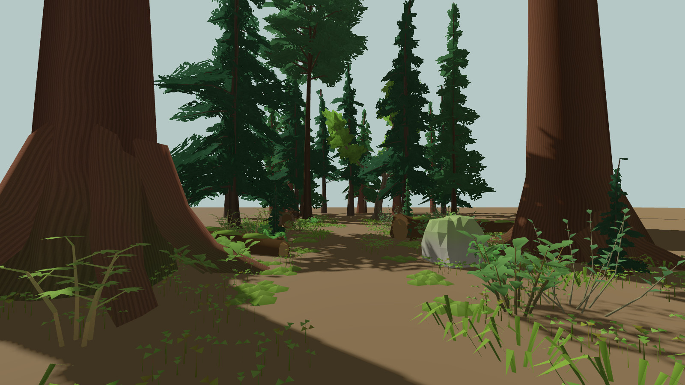
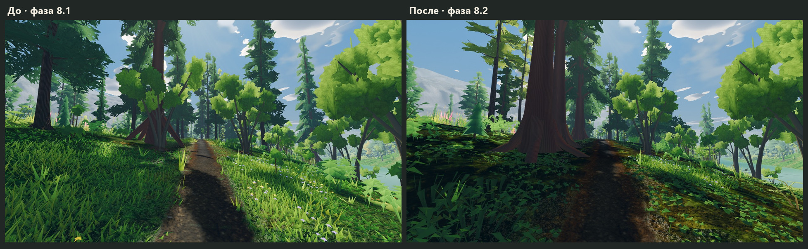

# Фаза 8.2 · Лес River Expedition

## Три яруса

- **Полог.** У тсуги и дугласии по восемь форм, включая четыре взрослые, две молодые и две старые. У тсуги ниже поникающие лапы и изогнут проводник, у дугласии выше посажена крона и толще ствол. Выбранные ели расширены, часть подроста ели и тсуги имеет высоту около 1,3–4 м. У западного кедра усилены комель, изогнутые корневые лапы и мох. У сибирского кедра утяжелены боковые лапы, у одной старой формы развита вторая вершина. Проверка массивов каталога подтвердила сохранность прежних форм клёна и лиственницы.
- **Средний ярус.** Две формы гаультерии с овальной листвой, две формы оплопанакса с пальчатыми листьями на черешках и высокий лесной ягодник. Новые кусты получают часть действующих весов подлеска, в том числе в сырых лесных пятнах и у воды. Мечевидный папоротник остаётся контрастной формой рядом с более крупным листом.
- **Подстилка и ковёр.** В валежнике появились 11-метровый цельный ствол, 8-метровое полое бревно и группа из двух стволов. У крупных форм есть сучья, наросты мха и ближние растения в том же меше. Корневые плиты стали шире. Контакты крупных брёвен строятся вдоль оси каждого ствола, след проходит через штатные проверки дороги, влаги, высоты и других объектов. Ковёр под пологом состоит из мха, мелколистных розеток, ягодника и осоки. Шейдер земли использует маску `ForestFloor` для влажного грунта, хвои, опада и пятен мха. Под сомкнутым пологом снижается доля обычных травяных пучков и цветов.

Тсуга, дугласия и изменения прежних форм используют общие атласы коры и хвои, три геометрических меша и формы `DistantForest`. Отступы подроста и коллизии утолщённых стволов учитывают масштаб и возраст. Низкие формы используют прежние сектора MultiMesh, буферный кэш плиток и нативный сборщик. Ковёр рисуется непрозрачной геометрией без теней. Изменения затронули ключ природы River Expedition. Каталог v18 занимает 4 800 561 байт против 4 009 145 байт у v17. После запекания совпали данные ресурса и сохранённой копии.

В работе использованы описания теневыносливого подроста тсуги, толстой коры дугласии и сочетания кедра, оплопанакса, папоротников и мхов на влажных участках побережья. [USDA Forest Service, тсуга](https://research.fs.usda.gov/silvics/western-hemlock) · [USDA Forest Service, дугласия](https://research.fs.usda.gov/silvics/douglas-fir) · [Лесные сообщества побережья Британской Колумбии](https://www.env.gov.bc.ca/wld/frpa/iwms/documents/Accounts_and_Measures_Coast.pdf)

## Сравнительные изображения

- [Тсуга и дугласия рядом с елью и западным кедром](river-expedition-phase82/new-trees.jpg). Фигуры высотой 1,8 м. У тсуги показаны размеры низкого подроста на плане.
- [Три геометрических LOD тсуги и дугласии](river-expedition-phase82/tree-lods.jpg).
- [Ель, западный и сибирский кедры до и после](river-expedition-phase82/changed-trees.jpg). Для каждой пары сохранены камера, свет и масштаб.
- [Гаультерия, оплопанакс, папоротник и ягодник в двух LOD](river-expedition-phase82/understory-lods.jpg).
- [Крупные брёвна, выворотни и замшелый камень](river-expedition-phase82/deadwood.jpg).
- [Луговой ковёр и четыре геометрии лесной поверхности](river-expedition-phase82/carpet.jpg).

Речной план «Север-1234», 384 × 1024. Камера в точке `2403:0` на высоте 1,65 м, штатная сцена `GameWorld`, свет на 10:30. В кадре видна смена луговых форм лесным ковром под стволами и открытая приречная кромка справа. Густые куртины гаультерии, высокие формы подлеска и крупные брёвна показаны на контролируемой композиции выше.

## Геометрия

Сумма треугольников ствола и кроны. Для старых пород указаны те же варианты до и после.

| Порода и форма | До, LOD0 / 1 / 2 | После, LOD0 / 1 / 2 |
|---|---:|---:|
| Ель, взрослая 0 | 768 / 156 / 80 | 768 / 156 / 80 |
| Западный кедр, старая 6 | 792 / 372 / 106 | 882 / 372 / 106 |
| Сибирский кедр, старая 6 | 538 / 192 / 60 | 564 / 208 / 70 |
| Тсуга, взрослая 0 | — | 792 / 186 / 104 |
| Тсуга, старая 6 | — | 792 / 258 / 104 |
| Дугласия, взрослая 0 | — | 772 / 324 / 80 |
| Дугласия, старая 6 | — | 772 / 324 / 80 |

При расширении форма 0 у ели сохранила число треугольников, а суммарная площадь карточек кроны LOD0 выросла с 699 до 1 027 м² в масштабе меша. У старого западного кедра в форме 6 она выросла с 1 892 до 2 644 м², у сибирского — с 1 491 до 2 357 м². Замер включает прозрачные участки и перекрытия. Фактический экранный overdraw требует отдельного профилирования. У старой дугласии площадь карточек снижается с 4 121 м² в LOD0 до 2 559 м² в LOD2.

Непрозрачные формы ковра дают 27/16 треугольников у мха, 81/36 у мелколистного ковра, 60/32 у ягодника и 45/30 у осоки. Луговая форма даёт 84/34. У цельного крупного ствола 407/161 треугольник, у полого 563/269, у пары 814/322. Новая корневая плита даёт 625/221.

## Проверки и производительность

- `dotnet build --no-restore`, запекание каталога и сравнение пикселей запечённых и исходных мешей на всех трёх LOD прошли. Без ошибок прошли проверки геометрии деревьев и подлеска, дальнего леса, политики стриминга и ключей кэша. Проверка чтения, восстановления и конкурентной публикации кэша дала 56 успешных проверок.
- На контрольном мире экспедиции раскладка C# и GDScript совпала побайтно. На плане 67 859 объектов против 70 185 до правки, в том числе 770 тсуг и 326 дугласий. Одиночные времена нативной раскладки составили 297 и 265 мс, GDScript — 2,18 и 2,27 с. Эти прогоны измеряли вычисление раскладки по подготовленным полям.
- В фикстуре ковра на 110 плитках совпали число экземпляров и вид каждой куртинки между C# и GDScript. Максимальное отличие компонентов буфера — 0,0000611. На трёх уровнях качества опубликовались все четыре вида ковра. Контактная фикстура приняла все три крупные формы валежника на сухом грунте, отклонила их у дороги и воды и создала 4, 4 и 8 капсул соответственно. Штатный `check.gd` дал совпадающий полный отпечаток живого мира `mountain_valley` «Sever-1234» (план 768 × 768). В 548 массивах геометрии LOD прежних деревьев, 19 старых растениях и 18 формах подстилки каталог совпал с исходным. Проверен [парный лесной кадр Типа 1](river-expedition-phase82/mountain-valley.jpg).
- `forest_floor_test.gd` сообщил 8 452 несоответствия проверки AABB и до правок, и после. Число экземпляров каждой проверяемой формы совпало. Сверка с исходной ревизией также воспроизвела четыре сбоя в `forest_collision_test.gd`, два в `vegetation_material_test.gd` и три в `vegetation_stream_integration_test.gd`. Windows сообщал об ошибке чтения системного хранилища сертификатов. Проверка уязвимостей NuGet осталась без доступа к источнику.

Проезд камеры на 210 м со скоростью 14 м/с, от той же точки под пологом. По одному проходу на ревизию, 1280 × 720, Compatibility / ANGLE, Intel HD Graphics 4600.

| Показатель | Фаза 8.1 | Фаза 8.2 |
|---|---:|---:|
| Кадров в выборке | 70 | 75 |
| Время кадра p50, мс | 195,9 | 184,8 |
| Время кадра p95, мс | 239,0 | 224,6 |
| Время кадра p99, мс | 244,8 | 241,8 |
| Вызовов отрисовки на кадр | 2 700 | 2 781 |
| Примитивов на кадр | 1,59 млн | 1,63 млн |
| Память по счётчику Godot, МиБ | 1 022,4 | 1 041,8 |
| Максимальное отставание покрытия, м | 141,4 | 141,8 |

На этом оборудовании обе версии отрисовывали около пяти кадров в секунду на выбранном участке. Новый лес увеличил число вызовов и примитивов при близком p99. ANGLE вернул нулевое время GPU. Таблица содержит статическую память движка по `OS.get_static_memory_usage()`. Одиночный проезд даёт замер на этом участке и настройках.

Открыты длительный проезд по всей экспедиции, проверка кадровой стабильности на разных настройках и оборудовании, отдельный замер экранного overdraw и памяти GPU, а также проверка естественной посадки крупного валежника на серии влажных участков. В фазе 9 предстоит настроить доли старых и широких форм, группы пород, плотный средний ярус отдельными пятнами, безопасное соседство с тропой и согласованный покров для влажного леса, горной тайги, поймы и открытых склонов. [Основной план](WORLD_TEMPLATES.md#фаза-9--распределение-растительности-в-типе-2-зональность-восьми-пород-вынос-правил-в-tres-папоротник-у-руля-и-валежник)
