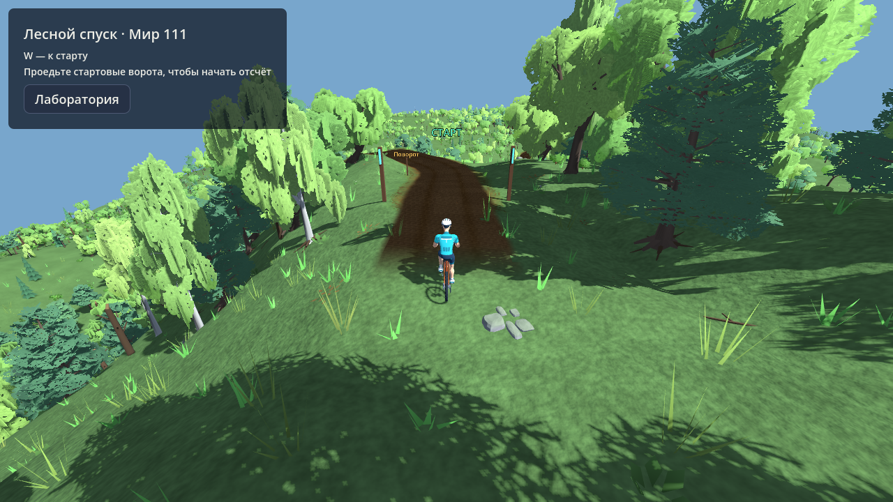
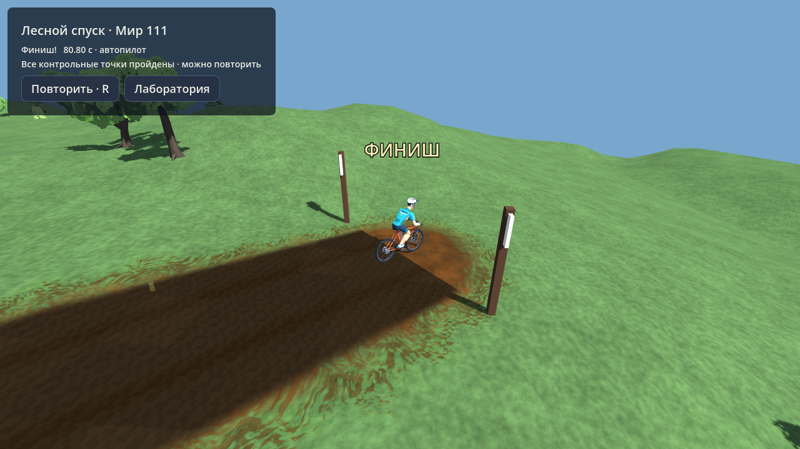

# Trail Lab: первые игровые примеры, 03.11.2026

Продолжение [подбора элементов](TRAIL_LAB_ELEMENTS_2026_11_03.md). Изменения ограничены лабораторией. Рабочая генерация основной игры, `BikeRide`, `BikeController` и общие стандарты не менялись.

## Этап 1. Торможение и геометрия

На тех же трёх снимках выполнены локальные и полные заезды настоящим `BikeRide + BikeController`, 60 Гц, без переносов и восстановления после ошибок. Отдельно проверены голая база и поверхность с элементами. У каждого заезда сохраняются станции, скорость, ввод, боковое отклонение, скольжение, удар, причина остановки и тип окончания. Диагностическая секция не выдаётся за законченный маршрут; полный заезд требует достижения настоящего финиша.

Исходные нарушения `7/30` и `111/0` присутствовали уже на базе. Поэтому исправление направлено на повороты и подходы. Новый ограниченный решатель использует интервалы нарушения с запасом подхода/восстановления: четыре окна сглаживания линии и четыре варианта профиля, максимум 16 предложений, отклонение не больше 8 м. Каждое предложение заново проходит контракт законченного маршрута, полную проверку земляных работ с откосами и прежний расчёт проезда. После изменения линии станции элементов перепроецируются, направление виражей обновляется, весь набор элементов повторно подбирается по новой поверхности. Неудачная попытка оставляет исходный проект неизменным.

Решатель включён в лабораторный `build_project` после диагностики голой базы. Ошибка, появившаяся только после элементов, остаётся задачей подбора элементов/связки и не запускает изменение базы. Сведения о правке сохраняются в отчёте проекта.

Исправлена также локальная правка земляных работ: направление поперечного смещения выбирается для целого проблемного интервала, поле смещения сглаживается. Прежний выбор стороны в каждой точке мог порождать короткие зигзаги.

| Место (индекс с нуля) | Результат |
|---|---|
| `111/42`, сид трассы `44101` | База и готовая трасса проходят расчёт и оба физических режима. Геометрия прежняя, 14 элементов. |
| `7/30`, сид `9066` | На шестом предложении найдена линия без расчётных нарушений; сохранены 6 элементов. Исправленная секция 14–77 м, затем весь маршрут пройдены осторожным пилотом. |
| `111/0`, сид `30794` | Все 16 предложений отклонены. Исходный полный заезд сходит с полотна около 124–125 м. Готовым примером не считается; отказ сохраняет исходный проект и источник. |

Для `7/30` выбрано окно линии 14 м и профиль с целевым уклоном 0.40, силой 0.60 и коротким выравниванием: линия стала плавнее, а полотно ближе к естественному склону. Это параметры геометрии, а не ослабление порогов проверки. Лимиты выемки/насыпи остались 2 м с прежним допуском 0.05 м; вода и инфраструктура остаются строгими запретами. У исправленной базы максимальная насыпь 1.926 м, выемка 0.841 м; у готовой трассы насыпь 1.942 м, выемка 0.841 м, запрещённых или чрезмерно изменённых вершин нет.

**Ограничение `7/30`:** заезд с прямым следованием расчётному скоростному профилю сходит на 31.7 м, тогда как осторожный полный заезд проходит с максимальным боковым отклонением 0.977 м. Быстрый/расчётный режим физически не подтверждён. Этот результат сохранён отдельно и не скрыт успешным осторожным проездом. Исправление всех режимов торможения на всех трёх местах ещё не завершено.

Данные: [исходные заезды базы и трассы](data/trail_braking_rides_2026_11_03.json), [правки, полные аудиты, секции и повторные заезды](data/trail_braking_repair_2026_11_03.json). Счётчики принятых маршрутов и обработанных отказов раздельные. Отдельный [сквозной прогон публичного построителя](data/trail_braking_pipeline_2026_11_03.json) на снимке `7/30` также автоматически исправил базу, сохранил 6 элементов, прошёл независимую итоговую сборку и физический заезд до настоящего финиша.

## Этап 2. Появление → старт → финиш → результат → повтор

В Trail Lab добавлен игровой режим на сохранённых проектах:

- **«Игровой пример · F10»** — мир `111`, место 43, 681.862 м, 14 элементов.
- **«Игровой пример · Мир 7»** — исправленное место 31, 347.849 м, 6 элементов.

Оба проекта содержат настоящий снимок окна мира, источник с масками, настройки и сид. Перегенерация мира и каталог в `.godot` для открытия не нужны. Исходные два проблемных проекта также сохранены в `resources/trails/lab/braking_case_*.tres`, чтобы диагностика и подбор воспроизводились независимо от локального кэша.

Перед стартом выбирается разрешённая точка с проверкой всего подхода и уклонов площадки. Допустимо боковое смещение до 1 м; пороги площадки сохраняются. Для `111/42` найдена точка за 8 м до старта; для `7/30` — за 2 м и на 1 м в сторону. До нажатия W велосипед неподвижен, таймер выключен. Отсчёт начинается при направленном пересечении стартовых ворот. Контрольные ворота через 20 м требуют последовательного физического прохождения, телепортация результата не даёт. Падение, сход и прерывание дают отказ попытки. После настоящего финиша показываются время и результат; R или кнопка «Повторить» возвращают на проверенную площадку без новой генерации. Автопилот отмечается явно и не устанавливает личный рекорд.

На реальной сцене выполнены по две полные попытки каждого примера: `111/42` — **80.80 с, все 35 ворот**, `7/30` — **42.30 с, все 18 ворот**. Второй запуск сделан через сигнал кнопки интерфейса. Источник не меняется между попытками. Эти времена относятся к осторожному автопилоту, а не к человеческому заезду или скоростной цели.

Данные: [четыре законченных игровых попытки](data/trail_trial_loop_2026_11_03.json).

## Начальная визуальная полировка

Полотно получило отдельный материал земли с вариациями зерна, слабыми следами колёс и мягкими краями, стартовый подход — плавное появление покрытия. Сетка лежит на фактической готовой поверхности; коллизии и высоты не меняет. Добавлены стартовые/финишные стойки и редкие предупреждения перед элементами. Во время попытки скрыты технические подписи и панели генератора.

Кадры получены рендерером самой сцены Godot и просмотрены после изменений. Финишный кадр снят после непрерывного физического заезда, состояние результата не подставлялось вручную.

Это первый проход визуальной полировки. Геометрия элементов и их читаемость требуют дальнейших человеческих заездов; физические тесты не доказывают выполнение всех задуманных прыжков. Упрощения воспроизведения полного мира в лаборатории остаются прежними.

## Проверки и воспроизведение

Целевые проверки: `trail_braking_ride_audit`, `trail_braking_repair_test`, `trail_braking_pipeline_test`, `trail_trial_loop_test`, `trail_trial_capture`; регрессии: `trail_base_surface_test`, `trail_validation_test`, `trail_element_fit_test`, `trail_project_ui_test`, `trail_element_rebuild_test`. Последняя проверяет публичный построитель и независимую сборку сохранённого примера `111/42` с совпадением источника и линии.

Запускать сценарии через Godot 4.7 в корне проекта: `godot --headless --path . --script tools/trail_trial_loop_test.gd`. Для кадров нужен обычный рендер: `godot --path . --rendering-method gl_compatibility --script tools/trail_trial_capture.gd`. Для ручного просмотра открыть `scenes/trail_lab.tscn`, затем F10 или кнопку второго примера.

Предупреждение окружения о системном хранилище сертификатов сохраняется; на результат этих проверок оно не влияет. Коммит текущей итерации не создавался.
